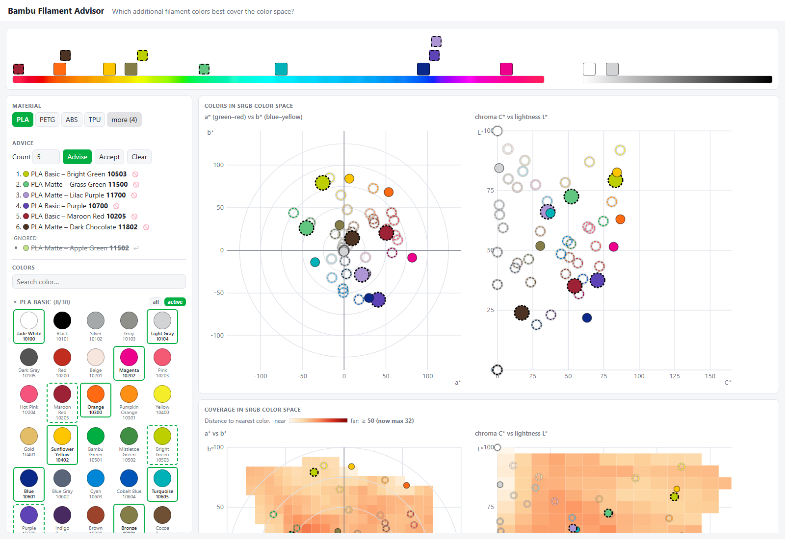

# Bambu Filament Advisor 

A single-page web app that answers the question: **which additional Bambu Lab filament colors would best
cover the color space, given the filaments I already own?**

You pick the filaments you have; the app places them in the CIE Lab color space, finds the gaps, and
recommends the colors from Bambu's catalog that close those gaps the most.

Try and use it at [pkoster.github.io/bambufilamentadvisor](https://pkoster.github.io/bambufilamentadvisor/)!



## What it does

- **Catalog** – lists Bambu Lab filament colors per material (PLA, PETG, ABS, TPU, …) and series
  (PLA Basic, PLA Matte, …). Colors have a name, the Bambu color number and the SKU.
- **Your selection** – click colors to mark them as owned, or paste text (e.g. an order confirmation) and
  import the Bambu color numbers / SKU codes it contains. The pasted text can be saved in the browser.
- **Active series** – only colors from series marked *active* are shown as owned and used as candidates
  for advice.
- **Advice** – asks for *N* extra colors and picks those that minimize the total distance from every point
  in the sRGB gamut to its nearest filament.
- **Ignore** – an advised color can be ignored with the 🚫 icon. It is not advised again, is left out of
  the coverage calculation, and another color is advised in its place. Ignored colors are listed below the
  advice and can be restored with ↩.
- **Visualizations** – the colors in sRGB (a\*b\* and C\*L\* plots), a coverage heatmap, an L\* slice with
  a play button, and a rainbow bar with owned and advised colors ordered by hue.
- **Sync** – refreshes the catalog from Bambu Studio's published color table (see below).
- **Configure** – Choose the distance metric (ΔE2000 or ΔE76), the range (sRGB or sRGB + 20 %) and the
  algorithm (greedy, multi-start, simulated annealing, or k-center, which minimizes the worst gap instead
  of the total gap).

Multi-color / gradient spools have no single point in color space, so they are skipped (but still
recognized on import).

## Running and deploying

There is no build step, no dependencies and no backend. Serve the files in this folder
from any web server, or open `index.html` directly in a browser.

**Local use**

Open `index.html` in your browser.

**Deploy** – copy these files to any web host:

```
index.html
favicon.svg
src/filamentadvisor.js
src/catalogsync.js
data/catalog.js
```

`scripts/sync-catalog.js` doesn't need to be deployed to serve the app. Optionally, a backend can run it on a
schedule (e.g. a cron job) to keep `data/catalog.js` in sync with Bambu's filament catalog.

### Updating the catalog

Bambu adds colors over time. The source is `filaments_color_codes.json` in the
[BambuStudio repository](https://github.com/bambulab/BambuStudio).

1. **Permanent** – run `node scripts/sync-catalog.js` (Node 18+) from the project root. It downloads the table
   and rewrites `data/catalog.js`. Then redeploy `data/catalog.js`.
2. **Temporary** – click **Sync filament** in the app. It fetches the table in the browser and uses it until the
   page is reloaded; `data/catalog.js` is not changed. This needs internet access from the browser.

## Files

| File | Purpose |
|---|---|
| `index.html` | The page: markup, styles, and the script includes. |
| `favicon.svg` | Browser tab icon, a simplified version of the "Colors in sRGB color space" plot. |
| `assets/screenshot.png` | Screenshot shown at the top of this README. |
| `src/filamentadvisor.js` | The app: color math (Lab, ΔE76, ΔE2000), the advice algorithms, ignore handling, charts and heatmaps, the catalog UI, import and the Sync filament button. |
| `src/catalogsync.js` | Converts Bambu's `filaments_color_codes.json` into the catalog shape (`buildCatalog`) and holds the source URL. Shared by the browser (Sync filament button) and Node (`scripts/sync-catalog.js`). |
| `data/catalog.js` | The filament catalog the app loads at start-up (`CATALOG` and `CATALOG_META`). Generated by `scripts/sync-catalog.js`; don't edit by hand. |
| `scripts/sync-catalog.js` | Node script that downloads the color table and writes `data/catalog.js`. Run with `node scripts/sync-catalog.js`. |
| `.github/workflows/sync-catalog.yml` | GitHub Action that runs the sync script every Monday (or manually) and commits `data/catalog.js` when the colors changed. |

## Attribution

The filament color data in `data/catalog.js` is derived from `filaments_color_codes.json` in
[BambuStudio](https://github.com/bambulab/BambuStudio) by Bambu Lab.

## Notes

- Filament selections are not stored between page loads. Only the import text can be saved, in the
  browser's `localStorage`.
- Colors are taken from Bambu's published hex values, which are approximations of the real filament colors.
